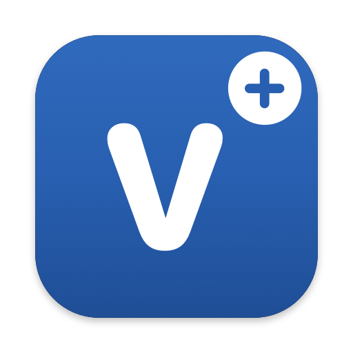

  

<h4 align="center">A macOS menu bar app for Viggo. Your schedule, homework and messages, without opening the website.</h4>

  

## What it does

- The menu bar shows what is on right now, like `Dansk → 14:15`, and the next thing when you are free. After school it switches to the everyday schedule: dinner, quiet hour, lights out.
- Click it for the panel: a "Now" card with time left, the rest of the day as one timeline, tomorrow, homework, messages and evening duty. Each part can be switched on or off, and there is a large text option.
- Tick homework as done right in the panel. It is saved in Viggo.
- Unread messages and questionnaires show as a number in the menu bar.
- Notifications when a lesson is moved, cancelled or changes room, when new homework or a new message arrives, and a morning and evening brief.
- Import into Apple Calendar as separate calendars (schedule, homework, events, everyday), kept up to date. One switch removes them again.
- Friends: a friend logs in on their own account in a private window. You see their day in the same layout, and when you are both free.
- Optional Focus during lessons, through two Shortcuts.
- Starts at login if you want.

## Logging in

You log in on Viggo's own login page inside the app, with UNI-Login, SkoleIT or a password, exactly as on the website. Viggo+ never sees or stores the password, only the session. It pings Viggo every few minutes so the session lasts as long as possible. When it runs out anyway, you get one notification and log in again with one click.

## Requirements

An Apple Silicon Mac with macOS 14 or newer, and a Viggo account.

The school is set in `Sources/Util.swift` (`Config.baseURL`, now `broeruphus.viggo.dk`). Change it to your own school's Viggo address and build.

## Install

1. Download the DMG from [Releases](https://github.com/otto-BigO/viggo-plus/releases).
2. Open it and drag Viggo+ to Applications.
3. The app is not notarized by Apple, so macOS blocks it the first time. Open **System Settings > Privacy & Security** and click **Open Anyway**.
4. Allow Calendar and Notifications when macOS asks, and log in from the settings window.

## Build from source

Needs the Xcode Command Line Tools (`xcode-select --install`).

- `./install.sh` builds the app, copies it to `/Applications` and starts it.
- `./build.sh` only builds it, to `build/Viggo+.app`.
- `./make_dmg.sh` builds the DMG in `dist/`.
- `swift Tools/makeicon.swift <dir>.iconset` and `iconutil` regenerate the icon.

## Good to know

- Viggo has no public API. Viggo+ reads the same pages and JSON the website uses while you are logged in, so a change on Viggo's side can break it.
- Everything stays on your Mac: the session cookies are in `~/Library/Application Support/ViggoPlus` (readable only by you), and the calendars are your own Apple Calendar.
- Viggo+ is a personal project and not made by or affiliated with Viggo or KOMiT.

## License

MIT. See [LICENSE](LICENSE).
