

  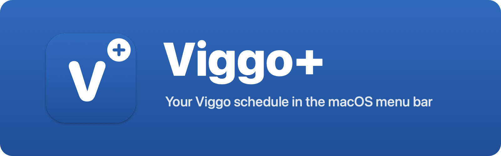

<h4 align="center">En menubar-app til Viggo på macOS. Dit skema, dine lektier og beskeder, uden at åbne hjemmesiden.</h4>

  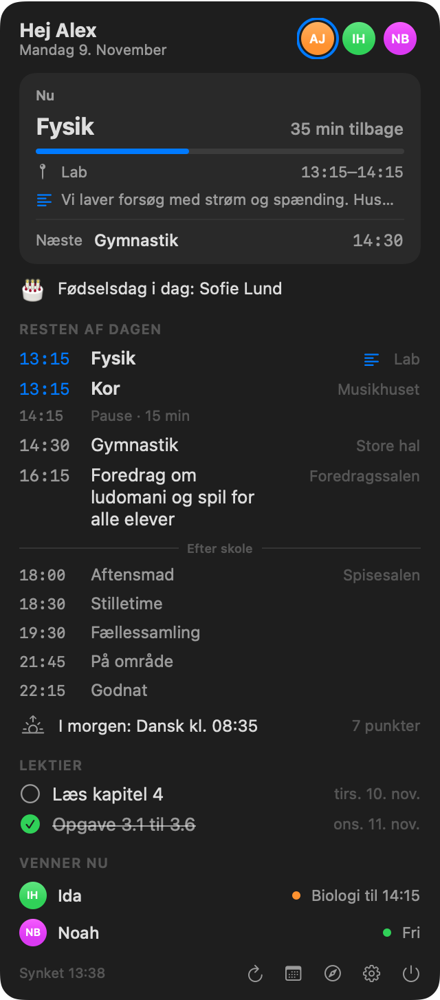
  &nbsp;&nbsp;
  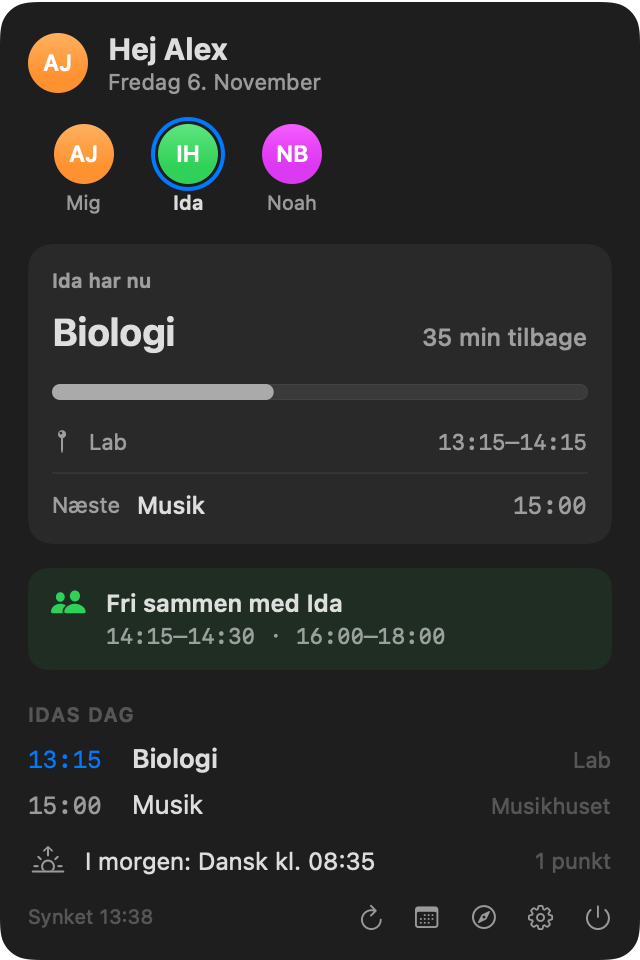

## Info fra læreren

Klik på en time i panelet eller uge-overblikket, så ser du hvad læreren har skrevet til timen: hvad I skal, hvad du skal læse eller have med, og links til videoer og filer.

  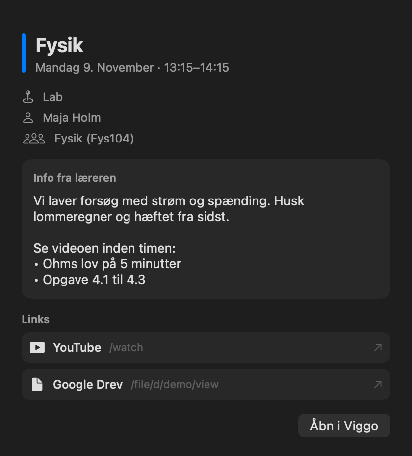

## Uge-overblik

Hele ugen med timer, middag, pauser mellem klassens timer og dine egne punkter.

  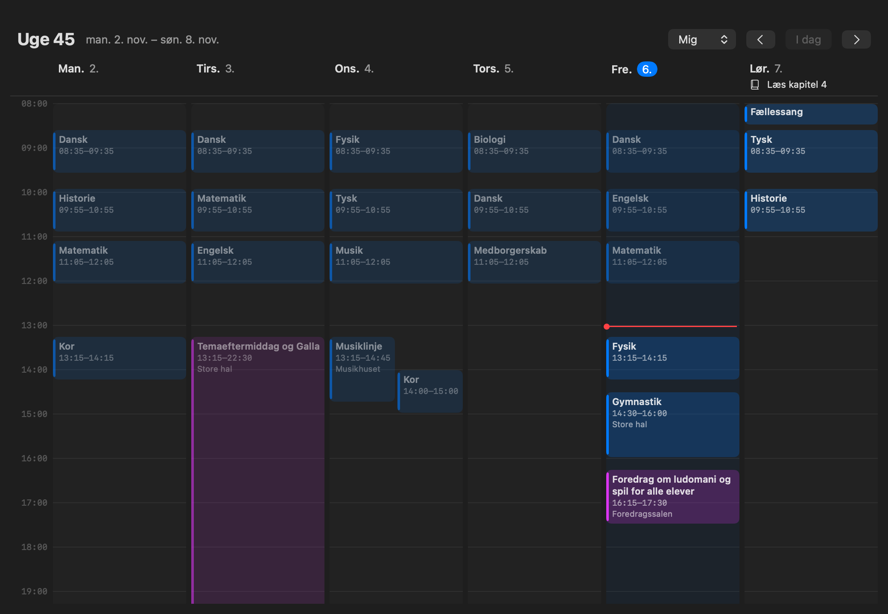

## Opdateringer

  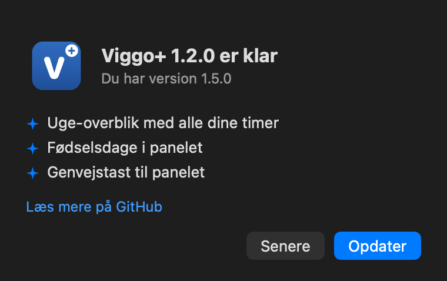

Viggo+ tjekker GitHub for nye versioner. Er der en, viser den kort hvad der er nyt, med et link til hele listen her på GitHub. **Opdater** henter den nye version og skifter den ind, uden at du skal hente en DMG. Det kan slås fra under Generelt.

## Indstillinger

Klik på en side for at se den.

<b>Konto</b>: Log ind og ud, og din profil.

 

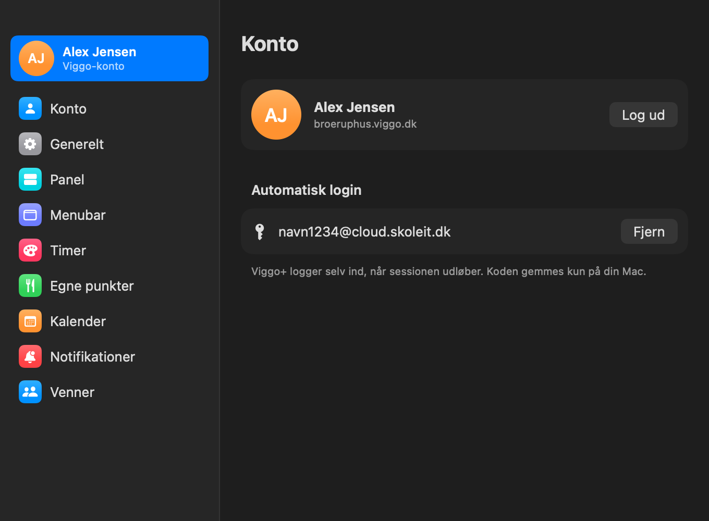

<b>Generelt</b>: Opdateringer, start ved login, genvejstast, tal i menubaren og fokus i timerne.

 

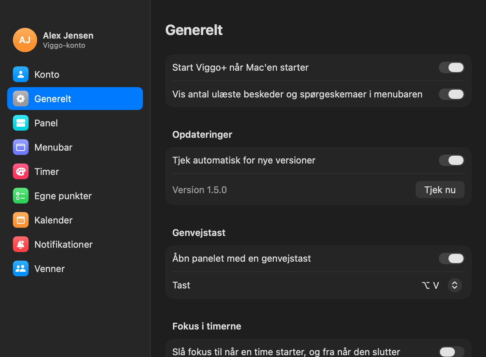

<b>Panel</b>: Hvad panelet viser, skjul det overståede og stor tekst.

 

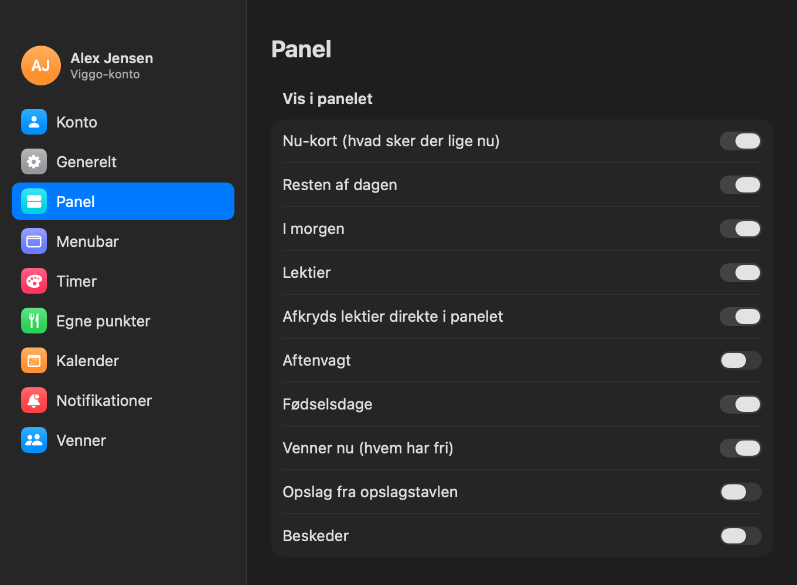

<b>Menubar</b>: Hverdag efter skoletid, og hvilke punkter der vises.

 

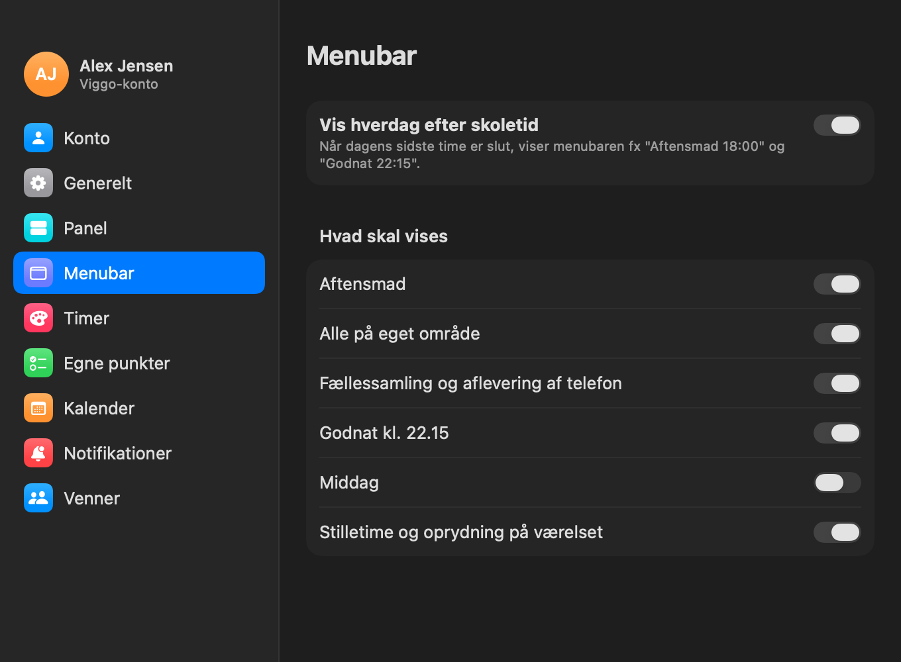

<b>Timer</b>: Egne navne og farver til dine timer.

 

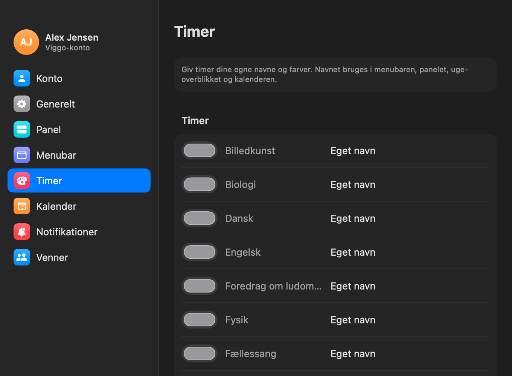

<b>Egne punkter</b>: Frokost, træning, lektier og andet du selv vil have med.

 

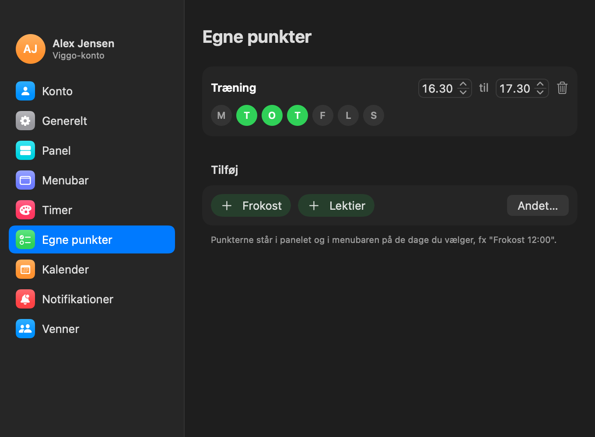

<b>Kalender</b>: Import til Apple Kalender og påmindelser.

 

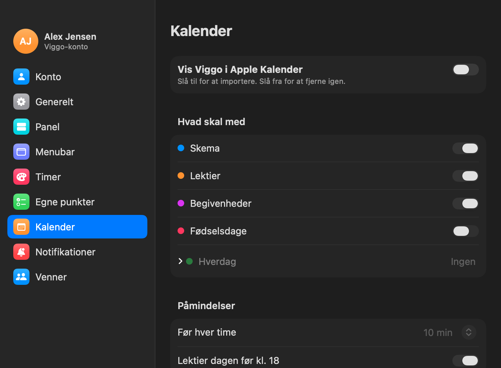

<b>Notifikationer</b>: Hvad du får besked om, og den daglige brief.

 

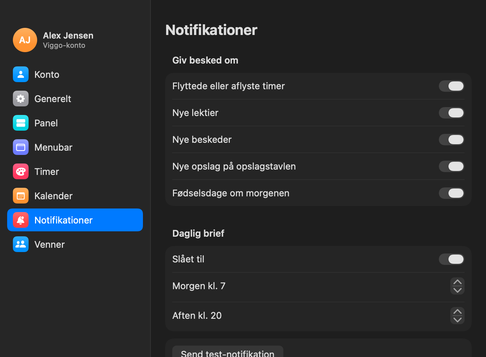

<b>Venner</b>: Dine venner, fri samtidig og tilføj ven.

 

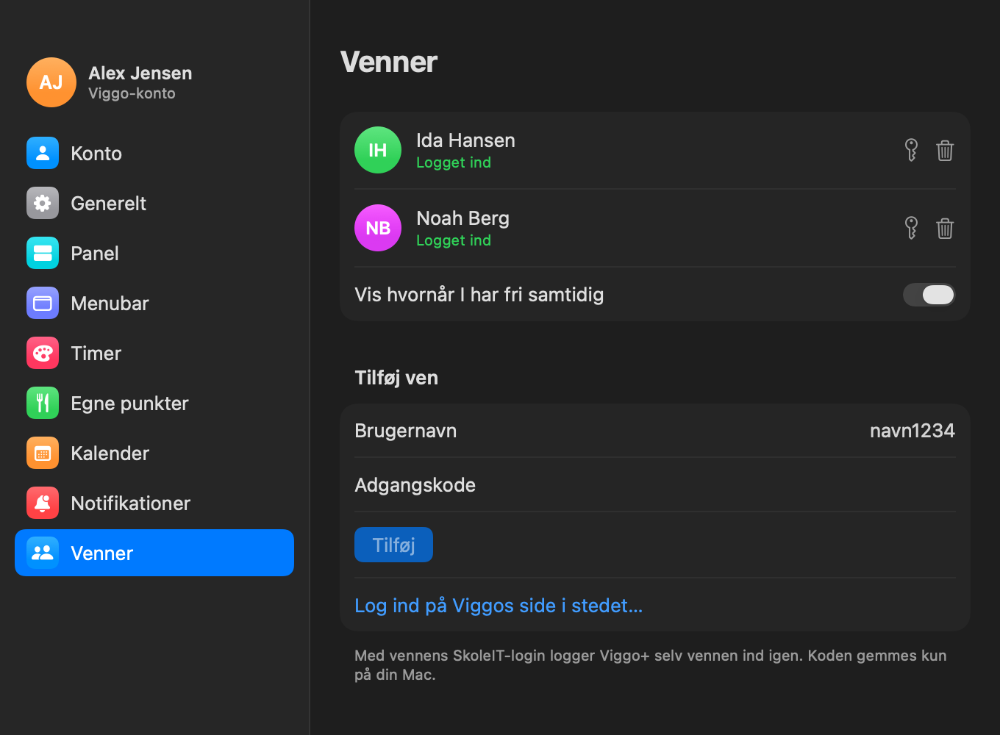

Billederne bruger opdigtede navne og et opdigtet skema. De laves med `./build.sh && build/Viggo+.app/Contents/MacOS/ViggoPlus --render-docs docs/screens`.

## Hvad den gør

- Menubaren viser hvad du har lige nu, fx `Dansk → 14:15`, og hvad der er næste gang når du har fri. Efter skoletid skifter den til hverdagen: aftensmad, stilletime, godnat.
- Klik på den for panelet: et "Nu"-kort med tid tilbage, resten af dagen som én tidslinje, i morgen, lektier, beskeder og aftenvagt. Hver del kan slås til og fra, og der er en indstilling med stor tekst.
- Klik på en time for at se lærerens info: hvad I skal, hvad du skal have med, og links til videoer og filer.
- Sæt lektier som færdige direkte i panelet. Det bliver gemt i Viggo.
- Ulæste beskeder og spørgeskemaer vises som et tal i menubaren.
- Et Beskeder-vindue som Mail: læs tråde som en chat, svar direkte og skriv nye beskeder med søgning på elever, lærere og grupper.
- Notifikationer når en time bliver flyttet, aflyst eller skifter lokale, når der kommer nye lektier eller en ny besked, og en brief morgen og aften.
- Import til Apple Kalender som separate kalendere (skema, lektier, begivenheder, hverdag), som holdes opdateret. Én kontakt fjerner dem igen.
- Venner: en ven logger ind på sin egen konto i et privat vindue. Du ser vennens dag i samme layout, og hvornår I begge har fri. Gemmer du vennens SkoleIT-login, logger Viggo+ også vennen ind igen af sig selv.
- Fokus i timerne, hvis du vil, via to genveje.
- Uge-overblik med hele ugens timer i kolonner, også for dine venner.
- "Venner nu": hvem af dine venner der har fri, og hvem der har time.
- Fødselsdage i panelet og som notifikation om morgenen.
- Notifikation når der kommer et nyt opslag på opslagstavlen.
- Giv timer dine egne navne og farver.
- Genvejstast (⌥ V) der åbner panelet.
- Opdaterer sig selv: når der er en ny version, får du en lille besked med det nye, og ét klik opdaterer appen.
- Kan starte når Mac'en starter.

## Login

Du logger ind på Viggos egen login-side inde i appen, med UNI-Login, SkoleIT eller adgangskode, præcis som på hjemmesiden.

**Automatisk login med SkoleIT** (valgfrit, under Indstillinger › Konto): gem dit SkoleIT-brugernavn (fx `otto1161`, `@cloud.skoleit.dk` sættes selv på) og din adgangskode, så logger Viggo+ selv ind når sessionen udløber. Den går de samme trin igennem som du ville: UNI-Login, Lokalt login, SkoleIT, brugernavn og kode, og tilbage til Viggo. Det sker i baggrunden uden et vindue. Adgangskoden ligger kun på din Mac, i en fil som kun din bruger kan læse, og **Log ud** eller **Fjern** sletter den. Det samme gælder dine venners koder under Indstillinger › Venner. Slår du det ikke til, gemmer Viggo+ aldrig din adgangskode, kun sessionen. Den pinger Viggo med få minutters mellemrum, så sessionen holder så længe som muligt. Udløber den alligevel, får du én notifikation og logger ind igen med ét klik.

## Krav

En Mac med Apple Silicon og macOS 14 eller nyere, og en Viggo-konto.

Skolen står i `Shared/Util.swift` (`Config.baseURL`, lige nu `broeruphus.viggo.dk`). Skift den til din egen skoles Viggo-adresse og byg appen.

## Installation

1. Hent DMG-filen under [Releases](https://github.com/otto-BigO/viggo-plus/releases).
2. Åbn den og træk Viggo+ over i Programmer.
3. Appen er ikke notariseret af Apple, så macOS blokerer den første gang. Åbn **Systemindstillinger > Anonymitet og sikkerhed** og klik **Åbn alligevel**.
4. Tillad Kalender og Notifikationer når macOS spørger, og log ind fra indstillingsvinduet.

## iPhone-appen

Der er også en iPhone-app i `iOS/`, med samme kode som Mac-appen (mappen `Shared/`). Den har:

- **I dag**: et stort Nu-kort med nedtælling, tal for dagen, dagens skema, mad, i morgen, lektier, beskeder og hvornår du har fri sammen med dine venner. Træk ned for at synke.
- **Uge**: én dag ad gangen, med ugens dage øverst. Swipe sideværts for at skifte dag.
- **Beskeder**: din Viggo-indbakke i appen. Læs tråde som en chat, svar, og skriv nye beskeder med søgning på elever, lærere og grupper.
- **Søg**: søg efter personer, klasser, værelser, linjer, grupper, beskeder, skema, lektier og opslag. Personsider viser klasse, linje, værelse, hvem man bor med, kontaktlærer, familie, fødselsdag og kontaktinfo.
- **Venner**: hvad dine venner har lige nu, og deres dag.
- **Indstillinger**: konto, I dag-skærmen, notifikationer, timer, egne punkter og venner.
- **Widget** til hjemmeskærmen (lille, mellem og stor med hele dagen og lektier) og låseskærmen, med det du har nu og hvad der kommer bagefter.
- **Lektie-widget**: dine lektier på hjemmeskærmen. Tryk på cirklen for at markere en som færdig, uden at åbne appen.
- **Siri og Genveje**: "Hvad har jeg nu i Viggo+", "Hvornår har jeg fri i Viggo+", lektier og i morgen. Virker uden at åbne appen.
- **Kontrolcenter**: en knap der viser hvad du har nu og åbner appen.
- **Notifikationer**: påmindelse før timer, morgen- og aften-brief og fødselsdage, også når appen er lukket. Flyttede timer, nye lektier, beskeder og opslag kommer når iOS lader appen synke i baggrunden.
- **Live Activity** i skoletiden: timen der er i gang med nedtælling på låseskærmen og i Dynamic Island. Kan startes uden at åbne appen med handlingen **Vis skoledagen** i Genveje (fx som automatisering kl. 7.45 på hverdage) eller fra Kontrolcenter.
- **Opstart i ASCII**: mens skemaet hentes, vises et landskab tegnet med tegn, i stil med en lo-fi radiostream. Om dagen sorte tegn på creme med skyer der driver og græs i vinden, om aftenen og natten grå tegn på sort med en stor ring, bjerge, skov og stjerner. Øverst står hvad der hentes.
- **Vælg din opstart**: under Indstillinger > Opstart vælger du mellem otte opstarts-animationer: de nye (Radio, Terminal, Skema, Nordlys, Stjernestøv) og de gamle (Ugle, ASCII-ikon, Ikon). Slå flere til, så får du en tilfældig hver gang.
- **Introduktion** første gang du er logget ind: widgets, Vis skoledagen som automatisering og knappen i Kontrolcenter. Den kan åbnes igen under Indstillinger.

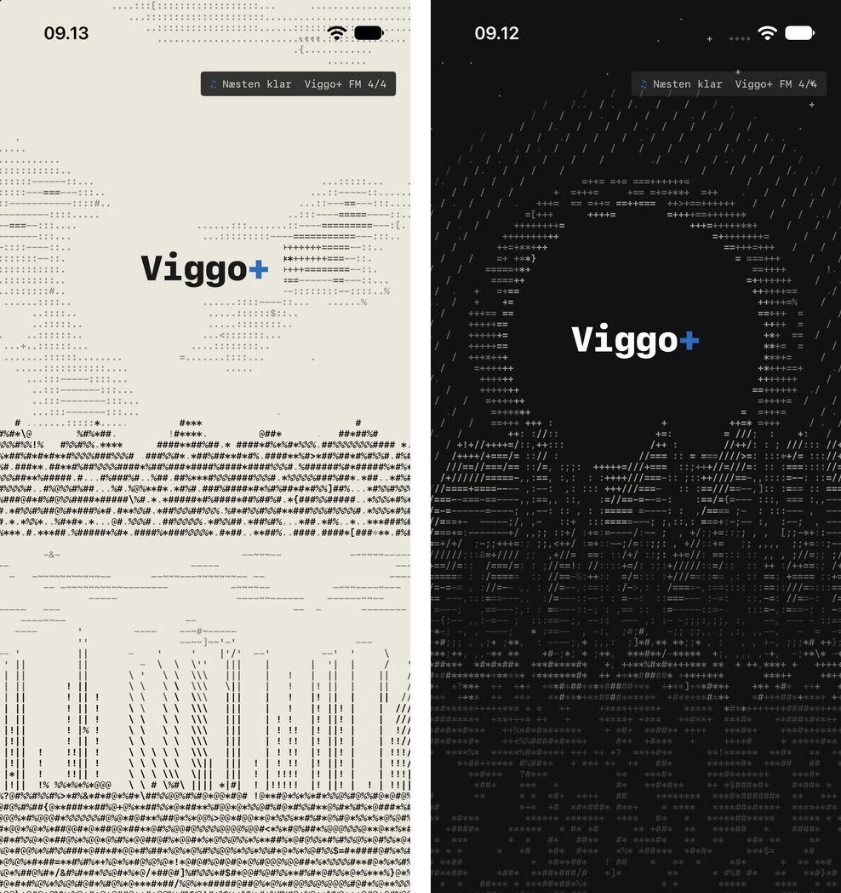

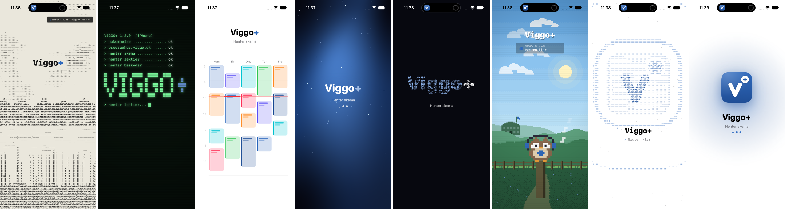

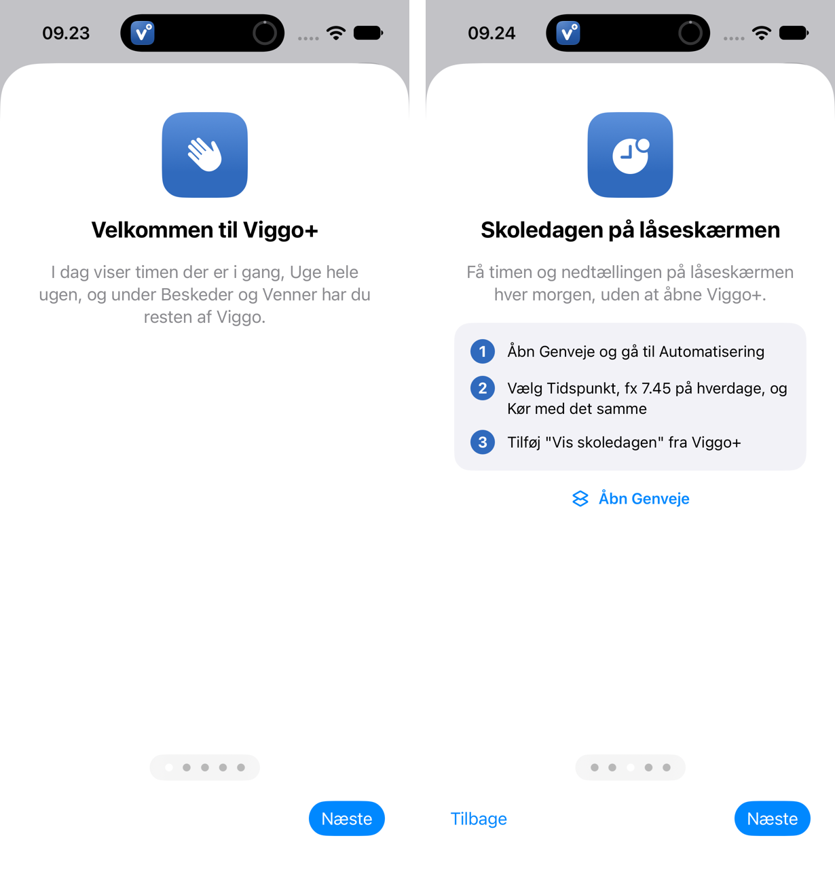

Den er ikke i App Store, men Viggo+ på Mac'en kan lægge den på din iPhone. Åbn **Indstillinger > iPhone-app** i Mac-appen. Der står hvad du skal bruge og hvor lang tid det tager, og en guide der krydser trinene af efterhånden:

1. Hent Xcode fra App Store (gratis, ca. 15 GB, 20 til 60 min).
2. Åbn Xcode én gang og vælg iOS (5 til 15 min).
3. Log ind med dit Apple-ID under **Xcode > Indstillinger > Apple Accounts**. Et gratis Apple-ID er nok.
4. Sæt iPhonen til med kabel, lås den op og tryk **Stol på**.
5. Slå **Udviklertilstand** til under **Indstillinger > Anonymitet og sikkerhed** på iPhonen.
6. Tryk **Installer** i Viggo+ (2 til 5 min første gang).
7. Første gang: stol på dit Apple-ID under **Indstillinger > Generelt > VPN og enhedsadministration** på iPhonen.

Dit login (og dine venner) sendes med fra Mac'en, så iPhone-appen er logget ind med det samme. Det kan slås fra, og der er en knap til at sende det igen.

Med et gratis Apple-ID virker appen 7 dage ad gangen og på højst 3 iPhones. Viggo+ fornyer den selv, når der er under 3 dage tilbage og iPhonen er på samme wifi som Mac'en eller sat til med kabel. Kablet skal kun bruges første gang. Det tager under et minut, iPhonen må gerne være låst, og dine data bliver liggende.

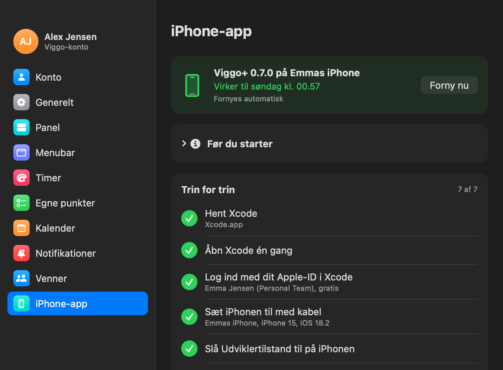

Udviklere kan også køre `iOS/install.sh` direkte (kræver XcodeGen).

## Byg selv

Kræver Xcode Command Line Tools (`xcode-select --install`).

- `./install.sh` bygger appen, kopierer den til `/Applications` og starter den.
- `./build.sh` bygger den kun, til `build/Viggo+.app`.
- `./make_dmg.sh` bygger DMG-filen i `dist/`.
- `./release.sh` bygger DMG og zip og udgiver versionen fra `Resources/Info.plist` på GitHub med noterne fra `CHANGELOG.md`. Zip-filen er den som appen selv henter når den opdaterer.
- `swift Tools/makeicon.swift <mappe>.iconset` og `iconutil` laver ikonet igen.

## Godt at vide

- Viggo har ingen offentlig API. Viggo+ læser de samme sider og den samme JSON som hjemmesiden bruger mens du er logget ind, så en ændring hos Viggo kan få den til at gå i stykker.
- Alt bliver på din Mac: sessionen ligger i `~/Library/Application Support/ViggoPlus` (kun læsbar for dig), og kalenderne er din egen Apple Kalender.
- Viggo+ er et personligt projekt og er ikke lavet af eller tilknyttet Viggo eller KOMiT.

## Licens

MIT. Se [LICENSE](LICENSE).
