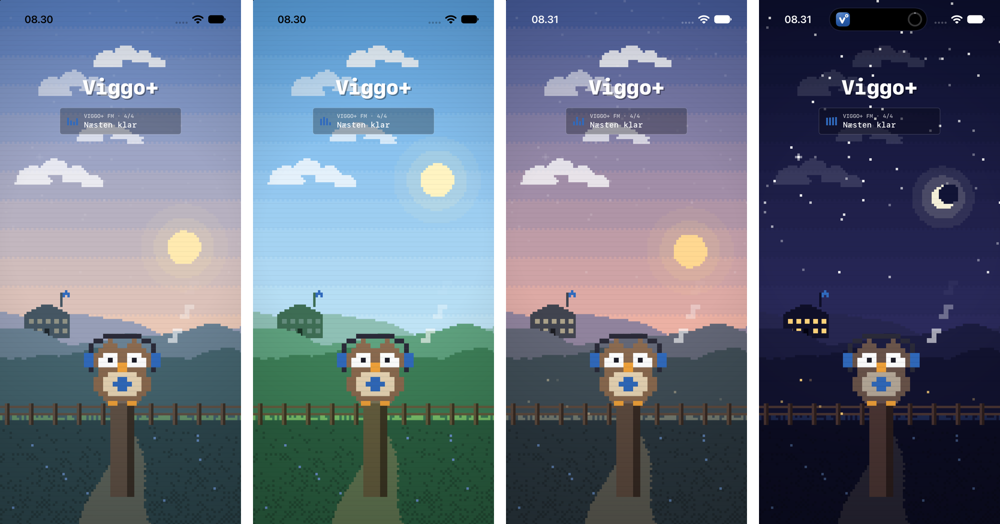
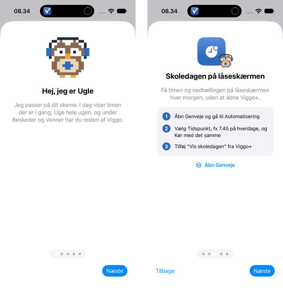

# Ugle og pixel-opstarten (iPhone-app 1.0.0)

Viggo+'s maskot Ugle og opstarten fra iPhone-app 1.0.0 (Mac 1.10.0, 2026-11-10). Den blev taget ud af appen i 1.1.0, men kan vælges igen under Indstillinger > Opstart fra 1.2.0 (iOS/Sources/Intros/OwlIntro.swift). Hele koden ligger også i git under tagget `v1.10.0`.

## Ugle

- En ugle på 16 x 16 pixels, tegnet som tekst i `owlOpen` (i `LaunchScreen.swift.txt`). Hvert bogstav er en farve: `B` krop (brun 8B6A4F), `L` lys mave (E9D6B5), `E` øjenhvidt, `P` pupil, `K` næb og `F` fødder (orange F2A33A), `H` høretelefoner og `X` "+" på maven i app-ikonets farve, `D` bøjlen over hovedet.
- Blink: `owlBlink` er samme sprite, hvor øjenrækkerne er byttet ud med lukkede øjne. Den blinker hvert 3,4 sekund.
- Nik: de øverste 8 rækker (hovedet) flyttes én pixel ned på slaget, 84 bpm (`sin(t * 84 / 60 * 2π) > 0.6`).
- I opstarten tegnes den med dobbelt pixelstørrelse og falder ned på pælen de første 0,55 s (`-(1 - t/0.55)^2 * 80`). Noder (en 3 x 3 pixel-ottendedelsnode) flyver op fra høretelefonerne og falmer over 3,3 s.
- `OwlView.swift.txt` er den selvstændige udgave, der blev brugt i introduktionen.

## Pixel-landskabet

- Alt tegnes i en `Canvas` på et groft gitter: én "pixel" er `bredde / 96` punkter (mindst 3).
- Himlen har 12 farvebånd med et skakternet dither i hver overgang. Farverne kommer fra fire paletter (nat, morgen, dag, aften), som blandes efter klokken: 0 til 5 nat, 7 morgen, 9.30 til 16.30 dag, 19 aften, fra 21.30 nat.
- Sol eller måne med to svage ringe som glorie. Månen er en skive med en himmelfarvet skive forskudt over sig, så den bliver en segl.
- 70 stjerner der blinker med hver sin fart, de klareste med et lille kryds.
- Skyer af fire runde klatter med flad bund, der driver mod højre.
- Tre lag bakker (summer af tre sinuskurver) der scroller med forskellig fart (parallakse). På det midterste lag står en skole med flagstang, vimpel i app-farven og vinduer, der lyser om aftenen.
- Forgrund: jord med dither, en sti mod beskueren, blomster, græs der svajer, et hegn og ildfluer i mørke.
- Til sidst scanlines (en tynd mørk linje hver anden række) og en vignet, så det ligner en stream. Fade fra sort de første 0,6 s.
- Under titlen et "VIGGO+ FM"-kort med en lille equalizer (4 søjler) og hvad der hentes.
- Testkroge: `VIGGO_SPLASH_T=2.6` fryser tiden, `VIGGO_SPLASH_HOUR=22` vælger tidspunkt.

Inspiration: stemningen i Anthropics Claude FM-stream (lo-fi musik med pixel-grafik). Ugle er Viggo+'s egen figur.
